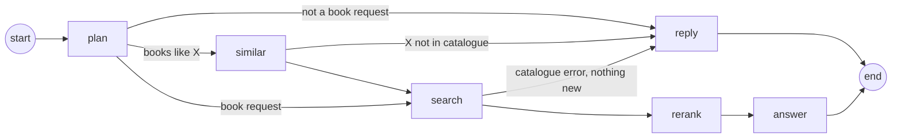

# Book Recommendation Agent: Design

How the agent in `backend/app/services/` turns a chat message into streamed, grounded book recommendations: the LangGraph pipeline, the decisions behind each step, how the tuning numbers were chosen, and what it cannot do yet.

The entrypoint is `stream_book_agent_response()` in `backend/app/services/book_agent.py`, which builds the graph. Each step lives in its own module under `backend/app/services/agent/`.

## Constraints

- **The index was rebuilt on my own Pinecone API key, with fewer books.** Gutendex, the source API, was unreliable and slow during development, so the `books-v1` namespace was first rebuilt with 100 books and later with **1,000 books** (633 authors, 91% English, no publication years). The numbers below were tuned on the small catalogue and re-checked on the full one with the evaluation set (`make eval`).
- **Pinecone metadata filtering is limited.** Filters are exact-value, pass/fail only: `$eq`/`$in` on strings and lists, numeric ranges, `$and`/`$or`. There is no partial, case-insensitive or regex match, no string ranges, and no "optional" or weighted clause. That is why the agent relaxes constraints by re-searching, matches titles by text rather than by filter, and needs the author name in the exact Gutenberg "Last, First" form.
- **Some limitations belong on the data side, not in the search.** Author-name variability ("Conan Doyle, Arthur" vs "Doyle, Arthur Conan"), title matching, missing publication years and cross-language duplicate editions are best fixed at ingest time, by storing normalized keys and enriched fields in the index, rather than by more heuristics in the agent. The agent handles them only as far as a search-time workaround goes; the data-side fixes are listed in [Possible next steps](#8-possible-next-steps).

## Solution in short

A stateless LangGraph pipeline behind the `/api/chat` SSE endpoint, with five steps: **plan** (one structured LLM call that gates intent and safety and extracts a store-agnostic `SearchPlan`), **similar** (for "books like X": looks X up in the catalogue and lets the LLM describe what it is like), **search** (Pinecone integrated-embedding search with metadata filters, relaxing constraints only when nothing matches), **rerank** (a 16-book shortlist, reordered by a cross-encoder whenever the search returned more) and **answer** (a streamed structured LLM reply, rendered to markdown as it arrives). Grounding is enforced in code: the model picks candidates by id, the book line is rendered from index data, and each pick must rate at least "partial" and quote evidence found in that book's data. Refusals, clarifications and error paths are fixed text. A typical request costs 2 LLM calls and 1 Pinecone search.

## 1. The graph

| Node | Module | LLM call | Pinecone calls | Job |
|---|---|---|---|---|
| `plan` | `agent/plan.py` | 1 | – | Is this a genuine, safe book request? If so, what is the `SearchPlan`? |
| `similar` | `agent/similar.py` | 1 | 1 + 1 per title | "Books like X": looks X up and describes what X is like |
| `search` | `agent/search.py` | – | 1, or 1 + one parallel round | Search with every constraint, relaxing only when nothing matches |
| `rerank` | `agent/rerank.py` | – | 0–1 | Shortlists 10 books, with a cross-encoder when constraints were dropped |
| `answer` | `agent/answer.py` | 1 (streamed) | – | Picks up to 5 books and streams the reply |
| `reply` | `book_agent.py` | – | – | Writes a fixed reply (refusal, clarification, errors) |

A typical request makes **2 LLM calls** (plan, then answer), **1 Pinecone search** and, when the search returned more than 16 books (every request without filters), **1 rerank call**. "Books like X" adds one LLM call and one lookup round; an author the model spells differently from the catalogue adds one lookup.

Shared modules: `models.py` (`SearchPlan`, `BookHit`, graph state), `conversation.py` (history helpers), `llm.py` (OpenAI client and the `structured()` call every step uses), `formatting.py` (markdown escaping).

## 2. A request, step by step

**"Something like Mark Twain, but darker"**

1. **plan** classifies the message as `book_request` and, in the same call, produces a plan with `similar_to_authors: ["Twain, Mark"]` and a first description of the request.
2. The plan names a reference author, so the graph routes to **similar**.
3. **similar** finds Twain's books with one exact metadata lookup. It sends their summaries, subjects and bookshelves to the LLM, which returns a search query ("humorous American adventure… darker tone") and a one-line note. The note is streamed to the user immediately. Twain is added to `exclude_authors`.
4. **search** runs the search with the new query. It has no filters, so it fetches the top 100, then drops books already recommended earlier in the conversation, excluded titles and authors (Twain's own books among them), and duplicate editions.
5. **rerank** sees more than 16 books, so the cross-encoder reorders them by the similarity query and the top 16 go on. If that call fails, the vector order stands.
6. **answer** streams the reply. For each pick the model first commits to a fit rating and quotes evidence from that book's data; only checked picks are shown, with their reasons streaming as they arrive.

## 3. Steps and decisions

### 3.1 Plan, part one — intent: `agent/plan.py`

One structured-output call does both the intent check and the filter extraction: the two used to be separate calls run in parallel, which cost a wasted extraction call on every refused message and a join node. Four classes: `book_request`, `needs_clarification`, `off_topic`, `malicious`.

- **Cheap checks first.** An empty message gets a clarifying question. A message over 2000 characters is rejected without an LLM call: no real book request needs that much text, and long inputs are where injection payloads usually hide.
- **Client `system` messages are never forwarded** to any LLM (`conversation.recent_conversation`). The API accepts `role: "system"` from the browser, so forwarding it would let users rewrite our instructions.
- **Dark themes are allowed on purpose.** War, crime, violence and death fill the classics, so the prompt marks them as legitimate interests. Harmful how-to requests disguised as book requests count as malicious.
- **Refusals use fixed text.** For off-topic and malicious messages the reply is a constant, not LLM text, so a manipulated model cannot change what the user sees. Only the clarifying question is LLM-written.
- **Fail closed.** An API error or unparsable output gives a generic error reply, never a search.

### 3.2 Plan, part two — the `SearchPlan`: `agent/plan.py`

For a `book_request` the same call fills a `SearchPlan`:

| Field | Meaning |
|---|---|
| `query` | Self-contained description of the books wanted (themes, genre, mood), because it is matched against summaries |
| `authors` | Books *by* these authors (Gutenberg "Last, First" form) |
| `languages` | Only when the user explicitly asks for a language |
| `published_after` / `published_before` | Year constraints |
| `prefer_popular` | "popular", "famous", "classic" |
| `exclude_titles` / `exclude_authors` | Books the user has read or does not want |
| `similar_to_authors` / `similar_to_titles` | Reference points for "books like X" |
| `follows_up` | Decided first: the latest message builds on earlier turns |

- **Names must come from the right place** (`keep_mentioned_names`). The model tends to add authors typical of a genre ("classic detective" → Conan Doyle), which turned genre requests into author filters, or excluded the best books. After extraction, a name is kept only if it is actually written where it may come from (surnames for authors, distinctive words for titles; fuzzy for words of 5+ letters):
  - `authors` and `similar_to_*` narrow or redirect the search, so they must be in the **latest** user message. Earlier turns count only for a follow-up ("more by him", "like the first one"). That needs both the model's `follows_up` flag and a back-reference word in the message (more, him, it, the first one, similar, shorter…): the model alone marked "something gothic" after a Twain request as a follow-up.
  - `exclude_*` are preferences the user stated ("I already read…", "no Dickens"), so the whole recent conversation counts. Books recommended earlier are excluded by id in code, not by the model.
- **`sanitize` clamps the LLM output**: years in −3000…2100 (swapped if reversed), 2-letter language codes, at most 5 authors, 3 references, 20 excluded titles, 500-character query.
- **The plan knows nothing about Pinecone.** Field names and operators live in `search.py` (`plan_constraints`), so the extraction step can be tested, and the index changed, independently.

### 3.3 Similar: `agent/similar.py`

Runs only when the plan names reference authors or titles.

- **Detecting "like X" is part of the plan call**, so it costs no extra LLM call, and its user-facing note cannot appear before the intent check passes: a malicious message never gets "Mark Twain is known for…" on screen.
- **Lookup:** one exact metadata search for all reference authors (`authors $in`, top 100), plus one text search per title (top 5), all run concurrently, so the lookup round costs one search's latency. Pinecone filters only match exact values, and catalogue titles are longer than what people type ("Frankenstein; or, The modern Prometheus").
- **Subjects and bookshelves are soft signals, not filters.** They are very narrow: only 2 books in the index have "Boys -- Fiction", and they are Twain's own. Filtering on them would mostly find the reference again. They go to the LLM, which writes the new query.
- **Unknown reference → ask, don't guess.** If none of the references is in the catalogue (e.g. Stephen King), the reply asks the user to describe the mood or vibe instead.
- **The reference is excluded:** "like Twain" recommends other authors, "like Frankenstein" excludes that title but not Mary Shelley.
- If the LLM description fails, the search runs on the plan's own description of the reference, without a note.

### 3.4 Search: `agent/search.py`

1. **Strict:** all constraints joined with `$and`, top 30 (`SEARCH_TOP_K`). A request without constraints fetches the top 100 instead (`BROAD_TOP_K`): there is no filter to narrow the pool, so the reranker gets a wide one. Most requests end here.
2. **Relaxed, only if nothing matched:** every smaller set of constraints is searched **at once** (`asyncio.gather`), each fetching the top 100, and the first set with results wins. The sets are ordered to drop as few constraints as possible, and the least important first: with years, language and author that is {language, author}, {years, author}, {years, language}, {author}, {language}, {years}, {}. Pinecone filters are strictly pass/fail, with no "optional filter" or should-clause, so this is how "drop as few constraints as possible" is expressed. The dropped constraints are reported as `relaxed_filters`.

Design points:

- **One round trip for the fallback.** Up to 7 searches run in parallel, but only on the rare fallback path; a strict hit costs one call.
- **Drop order: years → language → author.** Years are a soft preference and only approximated (below). The author goes last, because "books by X" is usually the point of the request.
- **Year filters fall back to author life years.** `first_publish_year` is missing from the whole index (the Open Library enrichment was never run on it). So "before 1900" means `first_publish_year ≤ 1900 OR max_author_death_year ≤ 1900`, and "after 1900" means `… OR min_author_birth_year ≥ 1900`. An author who died before 1900 wrote before 1900.
- **Author names are resolved to the catalogue's spelling before relaxing** (`resolve_authors`). Filters match exact strings, and the model writes "Dostoevsky, Fyodor", "Wells, H. G." or "Lovecraft, H. P." where the catalogue has "Dostoyevsky, Fyodor", "Wells, H. G. (Herbert George)". When a strict search with an author filter matches nothing, each name is searched as text (summaries name their authors), the authors of the books found are matched with `same_author` (word order, extra names, initials, accents and small spelling differences), and the strict search runs again with the catalogue names. The happy path stays one call; an unknown author costs one extra call and then relaxes as before. The resolved plan goes back into the state. The "books like X" lookup does the same for reference authors.
- **The author name goes into the fallback query text**, because the fallback steps may not filter on it.
- **Candidate clean-up** (`search`): drop books already recommended in this conversation, excluded titles (including longer full titles), excluded authors, and duplicate editions. Volumes of one edition ("[Vol. 8 of 9]") count as one work: the best-scoring record is kept.
- **No repeats across turns.** Every recommended book is rendered with its Gutenberg link. The ids are read back from earlier assistant messages (`recommended_book_ids`) without an LLM call, and excluded. The history is client-controlled, but a forged link can only *exclude* a book.
- **"Nothing new" stops the fallback.** If the strict search matched books but the user has seen or excluded them all, the agent says so (a fixed reply) instead of relaxing into books that miss the constraints.
- **Flags for later steps:** `relaxed_filters` (the user-facing names of the dropped constraints) and `exhaustive` (the strict search returned fewer than it asked for, so these are all the matching books).

### 3.5 Rerank: `agent/rerank.py`

- **Rerank whenever the pool is cut:** when the search returned more than the 16 candidates the answer weighs (`ANSWER_CANDIDATES`). The cut decides what the user gets, and vector order is the least reliable order there is; measured on the evaluation set, raw vector order missed well-known titles for broad themes. With 16 or fewer, the answer LLM judges them all and no reranker call is made, which is the usual case for a filtered search ("books by X").
- **Cross-encoder, not an LLM.** `pinecone-rerank-v0` reads query and summary together and took ~0.7–1.2 s. `bge-reranker-v2-m3` took ~2.3 s. `cohere-rerank-3.5` is not authorized for this project. The answer step is already an LLM ranker that knows the flags, so a second LLM ranking would duplicate it and add a call.
- **Crop by rank, not by score.** Vector scores are not comparable across queries (0.55 for Sherlock Holmes, −0.03 for French books), so a fixed threshold would drop everything for some queries. Up to 100 books go to the reranker, which is also `pinecone-rerank-v0`'s per-call maximum; the top 16 go on.
- **The reranker reads title, authors, subjects and summary** (`rerank_document`), cut to 1,000 characters: `pinecone-rerank-v0` rejects the whole request when one query+document pair exceeds 512 tokens (the earlier 1,500-character documents did, and the failures were silently caught).
- **The reranker gets the user's own words**, not the plan's rewritten query, unless the request is a follow-up or a "books like X" (`rerank_query`). Cross-encoders are trained on short natural queries. Measured offline on the 25 theme cases of the evaluation set (recall@16 of the graded books): vector order 0.67; reranked with the plan's query 0.74 (pool 30) / 0.76 (pool 100); reranked with the user's words 0.74 / 0.79. `bge-reranker-v2-m3` ranked worse than vector order (0.54) and was dropped from consideration. A pool of 100 costs about one extra second over 30 for the last few points; `BROAD_TOP_K` is the knob.
- **The reranker is a budget, not a given.** On the current Pinecone plan `pinecone-rerank-v0` allows 500 requests per month per organization and a per-minute limit; one evaluation run uses about 60 calls. When a call fails (rate limit, exhausted quota, outage) the failure is logged and the vector order is kept: the top 16 of the pool as the search returned it. The rerank client makes **one attempt with a 5 s timeout and no SDK retries** (`RERANK_TIMEOUT_SECONDS`, `RetryConfig(max_retries=0)`): a 429 is a per-minute or monthly quota that does not clear within a request, and the SDK's default three retries with backoff turned every failure into a 6 s wait on the critical path. Measured: a failing call costs 0.3 s instead of 6.3 s. `PINECONE_RERANK_MODEL=` (empty) switches reranking off altogether, for example while there is no quota.
- **Popularity only orders the shortlist, it never selects it.** With `prefer_popular`, the 16 most relevant books are sorted by download count; before, the top 32 were sorted and cut to 16, which let well-known off-topic books push matching ones out (Crime and Punishment for "dystopian novel", The Odyssey for "Greek tragedy"). The plan also sets the flag only for explicit "popular", "famous" or "bestselling" requests, not for "classic" or a genre. Download counts are a weak signal in this index anyway: every record with a Gutenberg id above 78,000 shows 24–25K downloads.
- If the reranker fails, the vector order is kept.

### 3.6 Answer: `agent/answer.py`

- **Grounding guarantee in code.** The LLM chooses books **by id** from the candidates, and the code checks every id before showing anything. See [3.7](#37-grounding-never-recommending-books-that-were-not-retrieved).
- **The answer step is the final filter, and a strict one.** Without checks, the model filled the list with loose matches (an Agatha Christie novel for "hackers thriller") and sometimes invented a justification ("Tom Sawyer … with dog characters"). Each pick now has, in this order:
  1. `fit`: `strong` (matches the core of the request), `partial` (core matches, a secondary wish does not) or `weak` (only generic traits, such as being a classic or having humour). The code drops `weak` picks.
  2. `evidence`: words copied from that book's summary or subjects. The code checks that at least 80% of its content words (stop words aside) appear in the book's title, summary, subjects or bookshelves, and drops the pick if not. This catches invented details the same way the id check catches invented books. Word coverage rather than exact phrases, because the model quotes in pieces and rewords slightly: real evidence measured 85–100% coverage, invented evidence ("Tom Sawyer … dog characters") 0–50%. An exact-phrase check dropped every pick of a normal request.
  3. `reason`, the text the user sees.

  The answer starts with `has_matches`, the model's own verdict. If it is false, the model's intro ("the catalogue has nothing on quantum computing…") streams as the answer. If it is true, the intro is held back until the first pick passes the checks. If none does, the user gets the fixed "couldn't find" reply instead of an intro that promises books.
- **True streaming.** `responses.stream(text_format=Answer)` is parsed incrementally with `jiter` (partial JSON). `AnswerRenderer` writes only what is new: reasons and closing stream token by token. A pick is checked when the model starts its `reason` key, because by then its id, fit and evidence are complete. Only then is its heading shown.
- **Fixed text where the model proved unreliable.** Three times the model ignored "don't say X": it repeated the dropped constraint in the intro, offered "more plays" when the catalogue had none, and restated the relaxation notice. So, in code:
  - When filters were dropped, the fixed notice replaces the model's intro.
  - When the results are exhaustive, the model's closing is dropped. "There are no other books in the catalogue matching your request" is added only if every candidate was recommended.
- **Escaping.** The frontend renders markdown as raw HTML, so every piece of book data and LLM text is escaped (`formatting.escape_markdown`, plus `escape_markdown_chunk` for streamed pieces).
- **Failure paths.** If the stream fails before anything is shown, the top 3 candidates are listed with the first sentence of their summaries. If it fails mid-way, the partial answer stays. No candidates gives a fixed "couldn't find" reply. If it fails after part of the reply was shown, a fixed line says that the rest was cut off (`INTERRUPTED_NOTICE`), so the reply never just stops mid-sentence.

### 3.7 Grounding: never recommending books that were not retrieved

The README requires that the agent "never recommends books that were not retrieved from the index". A prompt instruction alone cannot guarantee that: in this project the model ignored "don't do X" instructions several times. So the rule is enforced in code, in layers:

| Layer | How | Where |
|---|---|---|
| **1. The model returns ids, not titles** | Picks reference a candidate `book_id`; the model never writes the book line the user sees | `Answer` / `Pick` schema |
| **2. Every id is checked before anything is shown** | Candidates are `state["books"]`, the books the search returned, shortlisted by rerank. `_retrieved_book()` looks each pick's id up there. An unknown, repeated or empty id is dropped and logged (`Dropped pick with an id that is not a candidate`), before its heading or reason is written. | `AnswerRenderer._retrieved_book` |
| **3. The book line is rendered from index data** | Title, authors and link come from the `BookHit`, never from model text | `render_heading()` |
| **4. The justification is checked too** | `weak` picks are dropped, and the `evidence` must be found in that book's data | `AnswerRenderer._start_pick`, `is_grounded()` |
| **5. Error paths stay grounded** | The fallback list shows retrieved books with their own summaries; refusals and "not in the catalogue" replies are fixed text | `answer_node`, `similar.py`, `plan.py` |

The check is stricter than the README asks: ids are verified against the 16 candidates the answer step was given, not everything Pinecone returned. Live probes for books outside the catalogue (Harry Potter, The Hunger Games, 1984, Stephen King) all got an honest "not in the catalogue" reply.

**Remaining gap: free text.** The layers cover the *list* of recommendations. The model's free text around it (intro, reasons, closing) could still *name* a book that was not retrieved, e.g. "you might also enjoy Great Expectations". No id check can catch that. It did not happen in the probes, and the prompt allows only facts from the candidate data, but nothing in code prevents it. Options are listed in [Possible next steps](#8-possible-next-steps).

### 3.8 Reliability: budgets, fallbacks and the stream guard

Every external call is a read, so retrying is safe; the risk is a call that never returns. The SDKs already retry (OpenAI once more, Pinecone up to three times with backoff), so the agent adds **deadlines**, not retry loops:

| Budget | Value | Where | On expiry |
|---|---|---|---|
| One LLM attempt | 20 s (`LLM_TIMEOUT_SECONDS`) | `llm.py`, the shared client | the SDK retries once, then the step's own fallback applies |
| Silence in the streamed answer | 20 s (same setting) | `answer.py` via the shared client | partial answer kept and the cut announced, or the fallback list if nothing was shown |
| One Pinecone search | 10 s (`SEARCH_TIMEOUT_SECONDS`) | `search.find_books` | "catalogue unavailable" reply; a reference lookup falls through to the plain search |
| One rerank call | 5 s, no retries (`RERANK_TIMEOUT_SECONDS`) | `rerank.get_pinecone_client` | vector order is kept |
| The whole turn | 45 s (`TURN_TIMEOUT_SECONDS`) | `book_agent.stream_book_agent_response` | a fixed "took too long" line, after whatever was already streamed |

- **The stream always closes cleanly.** `stream_book_agent_response` wraps the graph run: a timeout or an unexpected exception is logged and ends the reply with a fixed line, so the client always receives the `done` frame instead of a broken connection.
- **Model fallback.** `structured()` (plan and similar steps) tries `OPENAI_FALLBACK_MODEL` (default `gpt-5.6-luna`) once when the primary model's call fails. A refusal or empty output is not retried: that is a decision about the input, not a transport failure. Set the variable empty to disable. The streamed answer has no model fallback; its failure path is the fallback list from the search results.
- **Plans are not pinned.** The structured calls ran at `temperature=0` with the gpt-4.1 models; the current default models reject the parameter, so it was removed, and the same request can get a slightly different plan between runs (in four evaluation runs, two cases flipped on the plan alone). The guards in the plan step (names, languages, sanitising) bound what a flip can do.
- **Per-step fallbacks** (unchanged): plan fails closed; reference lookup or description failure falls through to the plain search; rerank failure keeps vector order; answer failure lists the top 3 with their own summaries, or announces the cut when part of the reply was already shown.
- A Pinecone call that exceeds its budget is abandoned, not cancelled: it runs in a thread and finishes on its own. The fan-out on the fallback path (up to 7 concurrent searches) is not capped yet.

## 4. State

`AgentState` (`agent/models.py`) is a `TypedDict` without reducers: each node returns a partial update that overwrites those keys. The graph is a single path, so no two nodes ever write in the same step. There is no checkpointer: the browser sends the full history with every request, so the server is stateless.

| Key | Set by | Used by |
|---|---|---|
| `messages` | input | all LLM nodes, `recommended_book_ids` |
| `reply` | plan, similar, search | routing, reply |
| `plan` | plan (query and exclusions updated by similar) | search, rerank, answer |
| `books` | search, then cut by rerank | rerank, answer |
| `relaxed_filters` | search | rerank, answer |
| `exhaustive` | search (cleared by rerank if it cuts) | answer |

One LangGraph detail to know: a key returned by a node but not declared in `AgentState` is **silently dropped**.

## 5. The numbers and why

| Constant | Value | Where | Why |
|---|---|---|---|
| `MAX_MESSAGE_CHARS` | 2000 | conversation | Longer messages are rejected before any LLM call. It is also the per-message cap on what LLMs see. |
| `HISTORY_WINDOW` | 6 turns | conversation | What every LLM call sees. Enough to resolve follow-ups ("more like the second one") while keeping prompts small |
| `SEARCH_TOP_K` | 30 | search | A filtered search: room for duplicate editions, exclusions and books already shown, with no reranker call in the usual case. Fewer than 30 matches from a filtered strict search means the result is exhaustive. |
| `BROAD_TOP_K` | 100 | search | An unfiltered or relaxed search: the reranker's pool, and its per-call maximum. |
| `ANSWER_CANDIDATES` | 16 | rerank | Candidates the answer LLM weighs (about 5K prompt tokens). Also the rerank threshold: with 16 or fewer, the answer judges all of them. |
| `RERANK_DOCUMENT_CHARS` | 1000 | rerank | Title, authors, subjects and summary. `pinecone-rerank-v0` rejects the whole request when one query+document pair exceeds 512 tokens; 1,500 characters did, silently. |
| `RERANK_QUERY_CHARS` | 300 | rerank | The user's words as the rerank query, cut so that query plus document stay under the same limit |
| `AUTHOR_RESOLVE_TOP_K` | 50 | search | Books searched by an author's name as text to learn the catalogue's spelling; summaries name their authors, so the right books are near the top |
| `MAX_PICKS` | 5 | answer | A readable reply. Fewer is fine when fewer fit. |
| `MIN_EVIDENCE_COVERAGE` | 0.8 | answer | Share of the evidence's content words that must appear in the book's data. Real evidence measured 0.85–1.0, invented evidence 0–0.5. |
| `SUMMARY_CHARS` | 700 | answer | 16 candidates × 700 chars keeps the answer prompt small. Summaries are short anyway. |
| Popularity shortlist | top 32 → 16 | rerank | Relevance picks the shortlist first (2 × 16), so "popular" never means "popular but off-topic" |
| Fallback list | 3 books | answer | When the LLM fails, show a few safe picks with their own summaries |
| `AUTHOR_LOOKUP_TOP_K` | 100 | similar | All books by up to 3 reference authors in one call |
| `TITLE_LOOKUP_TOP_K` | 5 | similar | The title is usually first; a few extra cover duplicate editions |
| `MAX_REFERENCE_BOOKS` | 6 | similar | Enough data for the LLM to describe a reference without a huge prompt |
| `REFERENCE_SUMMARY_CHARS` | 600 | similar | Same reasoning as `SUMMARY_CHARS` |
| `sanitize` limits | 5 authors, 3 references, 20 excluded titles, 10 excluded authors, 500-char query, years −3000…2100 | plan | Bound what an LLM can put into a Pinecone filter |

Measured on this index (median of a few runs):

| Operation | Time |
|---|---|
| One Pinecone search, any `top_k` | ~1.9 s median. The starter `search_books` builds a client and describes the index on every call; with a cached handle the same search takes ~0.2 s. The helper is part of the task and is left as is. |
| Cross-encoder rerank of 30 / 100 | ~0.8 s / ~1.8 s |
| Whole request (evaluation set, 70 cases) | p50 7.3–8.7 s, p95 12.8–15.7 s; the streamed answer itself takes ~1.2 s |
| "Books like X" | 9–12 s, with the note appearing after ~5–6 s |

## 6. Configuration

| Variable | Default | Used for |
|---|---|---|
| `PINECONE_API_KEY` | – | Search and rerank |
| `PINECONE_INDEX_NAME`, `PINECONE_NAMESPACE` | `books`, `books-v1` | Which index to search |
| `OPENAI_API_KEY` | – | All LLM steps |
| `OPENAI_MODEL` | `gpt-5.6-terra` | All LLM steps. The evaluation numbers in section 9 marked gpt-4.1-mini were run with `OPENAI_MODEL=gpt-4.1-mini OPENAI_FALLBACK_MODEL=gpt-4.1` |
| `OPENAI_FALLBACK_MODEL` | `gpt-5.6-luna` | Tried once when the primary model's call fails (plan and similar steps); empty disables |
| `PINECONE_RERANK_MODEL` | `pinecone-rerank-v0` | Cross-encoder rerank; empty disables it |
| `LOG_LEVEL` | `INFO` | Agent logs (intent, search plan, filters, rerank, dropped picks, timeouts), printed next to uvicorn's |

Timeouts are constants, not variables: `LLM_TIMEOUT_SECONDS` (20), `SEARCH_TIMEOUT_SECONDS` (10), `TURN_TIMEOUT_SECONDS` (45). See [3.8](#38-reliability-budgets-fallbacks-and-the-stream-guard).

## 7. Known limitations

**Rough edges**
- **Strict picks mean shorter lists.** The fit and evidence checks prefer two or three good picks over five loose ones. Every dropped pick is logged (`Dropped pick …`).
- **The evidence check proves facts, not fit.** It shows the quoted words are really in the book's data, not that the book matches the request. Whether it matches is the model's `fit` rating: "funny books about dogs" can still return *Alice's Adventures in Wonderland*, whose evidence (it is funny) is real, although it is not about dogs.
- **Free text can name books that were not retrieved.** See [3.7](#37-grounding-never-recommending-books-that-were-not-retrieved): the recommended list is checked in code, the surrounding prose is only guided by the prompt.
- **The intro arrives in one piece** when there are picks, because it is held back until the first pick passes the checks. The reasons still stream.
- **Nothing on screen for the first ~5 s** while plan and search run. Only "books like X" shows an early note.

**Catalogue limits**
- **1,000 books, mostly English, no publication years** (see [Constraints](#constraints)). Year filters approximate from author life years, and books with no author years never match a year filter.
- **Author names are of poor quality.** Of the 1,000 records, 47 have no author at all (Beowulf, the Bible, anthologies), 13 are "Various", "Anonymous" or "Unknown", 31 list several people without saying who is author, co-author, editor or translator (Dumas with Maquet, Marco Polo with Rusticiano, Burns with his editor), 123 carry parenthesised expansions ("Wells, H. G. (Herbert George)"), a few are institutions ("Great Britain. War Office", "United States. Warren Commission"), and the spelling is Gutenberg's, which differs from common usage ("Dostoyevsky" for Dostoevsky, "Doyle, Arthur Conan" for Conan Doyle). Consequences: an author filter can only ever match the exact string, so the agent resolves names by a text search (3.4); books without an author never match an author or a year filter; "books by Dumas" also returns his collaborator's records; and "more by her" after an anthology has nothing to hold on to. The real fix is at ingest: one normalised author key per person, a role per name, and aliases.
- **No length information.** "A short book" is silently ignored.
- **Few books per author.** Most of the 633 authors have one or two titles, so author requests are often exhaustive, and "more" quickly reaches "already shown".
- **Duplicate editions across languages** ("Crime and Punishment" and "El crimen y el castigo") are not merged and can take two of the 10 candidate slots.

**Matching limits**
- **Author names are resolved by a search, not by the filter.** Pinecone filters have no partial, case-insensitive or regex matching, so a name the model spells differently from the catalogue costs an extra text search to resolve (see 3.4). The resolution relies on summaries naming their authors; a data-side author key at ingest would make it a plain filter.
- **A language filter needs a language request** (`keep_requested_languages`). The model filters on the language the user writes in ("Recommande-moi un roman policier" → French books only) and on nationalities ("Russian literature" → Russian). A language code survives only when the message names the language with a cue ("in French", "en français", "written in Chinese", "German edition", "Italian books"); the table covers the catalogue's languages in the main languages users write in, and unknown codes are trusted.
- **Follow-up detection is English-only.** The back-reference words are English, so in another language a follow-up such as "more by him" loses names that were only in earlier turns. The search then falls back to the query text.
- **Follow-ups rely on our links.** "Already recommended" is read from Gutenberg links in earlier replies. A client that strips them would see repeats.

**Engineering**
- **Tests run offline.** `make test` runs the pytest suite in `tests/`: a fake LLM that answers by schema and streams the answer JSON in pieces, and an in-memory catalogue with Pinecone's filter semantics (`tests/conftest.py`). One module per step (`test_plan.py`, `test_search.py`, `test_rerank.py`, `test_similar.py`, `test_answer.py`), `test_pipeline.py` for flows through the whole graph, and `test_reliability.py` for timeouts, the model fallback and the stream guard. Nothing talks to OpenAI or Pinecone, so the 82 tests run in a few seconds; behaviour against the live services is measured with the evaluation set below.
- **Quality is measured against the live services.** `make eval` runs `evals/run_eval.py` over `evals/dataset.json`: 70 conversations with the books that should be recommended (graded, "ideal" counts double), books that must not appear, and the fixed reply expected for non-search turns. Relevance can be given as ids or as a metadata rule (`relevant_where: {"authors": [...]}`) resolved against `evals/catalogue.json`, a snapshot of the index (`--refresh-catalogue`). It reports nDCG@5, precision and recall of the picks, MRR, retrieval recall@10 of the candidates (to tell retrieval failures from answer-selection failures), forbidden and hallucinated ids, behaviour accuracy and latency, per category and overall, and compares two runs with `--baseline`. A case passes when behaviour matches, nothing forbidden or unknown was recommended and nDCG@5 is at least 0.5. The first run on the 1,000-book index passed 51 of 70; the failures are listed in [section 8](#8-possible-next-steps).
- The OpenAI client is cached per process and bound to its event loop. That is fine under uvicorn; scripts calling `asyncio.run` several times need a fresh client.

## 8. Possible next steps

1. Close the free-text gap: a prompt rule against naming books other than the picks, plus either dropping the closing (where "you might also enjoy…" lines go) or checking quoted titles in intro, reasons and closing against the picks.
2. Tune strictness with real queries: e.g. allow `partial` picks only when there are fewer than 2 `strong` ones.
3. Stream a short status line ("Searching the catalogue…") once the intent check passes.
4. **Data-side fixes at ingest time** (see [Constraints](#constraints)): a normalized `title_key`, so titles can be matched by metadata filter instead of text search; normalized author keys and aliases, so "Dostoevsky" and "Dostoyevsky, Fyodor" meet without fuzzy matching in the agent; real publication years from Open Library, so the author-life-year approximation can go; a `work_key` shared by all editions, volumes and translations of a work, so duplicates are merged by filter rather than by title heuristics.
5. Merge cross-language editions, or prefer the user's language (a `work_key` above covers this).
6. Use a smaller, faster model for intent and filters if latency matters more than nuance.
7. **Open findings from the evaluation set** (the fixed ones are in the [decision log](#9-decision-log)): (a) a reference named through a character or series ("something like Sherlock Holmes") is dropped by the name guard and the reference books come back as recommendations; the fix is to have the plan return, with each reference, the exact words the user used for it, and to accept a multi-word title contained anywhere in a catalogue title; (b) "books like X" retrieval is weak when the similarity profile is generic prose ("like Jules Verne but in English" returns adventure books, Wells at rank 96); a better route is to use the reference books' own subjects and bookshelves as a filter or as query text; (c) the embedded text is only title and a 550-character summary, so thematic requests miss books whose summary does not use the theme's words (Moby Dick at rank 35–78 for "obsession and revenge" although its subjects say so); embedding subjects, bookshelves and an LLM-written themes line at ingest is the fix.

## 9. Decision log

Decisions taken on 2026-10-29 with the evaluation set (`make eval`, 70 cases) as the instrument. Each entry gives the evidence and what was rejected, so the same ground is not covered twice.

| # | Decision | Evidence | Rejected |
|---|---|---|---|
| 1 | **Measure with graded relevance.** nDCG@5 of the picks is the headline; retrieval recall@10 of the candidates tells retrieval failures from answer-selection failures; forbidden and hallucinated ids and behaviour accuracy are hard checks. | First run: 51/70 passing, 11 cases failing in every run, each traced to a mechanism rather than to model noise. | An LLM judge: slower, costlier, and not needed when the expected books are known. |
| 2 | **16 candidates to the answer step** (was 10). | On the 33 theme and "like X" cases, an ideal book was among the candidates in 29/33 cases with 10 and 33/33 with 16; about 2K more prompt tokens. | Fewer than 16 strict results (proposed 16): duplicates, exclusions and already-shown books are removed after the fetch, so a 16-fetch leaves 8 or fewer. Strict stays at 30. |
| 3 | **Rerank whenever the pool is larger than the shortlist**, not only when constraints were dropped; a filtered search fetches 30, an unfiltered or relaxed one 100; the reranker gets the user's own words and a 1,000-character document. | Offline on 25 theme cases, recall@16: vector order 0.67; reranked with the plan's query 0.74 (pool 30) / 0.76 (pool 100); with the user's words 0.74 / 0.79. The 1,500-character documents made `pinecone-rerank-v0` reject about 1 request in 15 (512-token limit), silently. | `bge-reranker-v2-m3`: 0.54, worse than vector order. Reranking only above 30 candidates: the cut matters whenever the pool exceeds 16. A pool of 100 without a reranker: pure cost. |
| 4 | **A failed rerank call keeps the vector order**, nothing more, and it fails fast: one attempt, 5 s timeout, no SDK retries; an empty `PINECONE_RERANK_MODEL` switches reranking off. | The plan allows 500 rerank requests a month per organisation; one evaluation run uses about 60; the live eval could not confirm the offline gain before the quota ran out. | A 60 s pause after a failure with a smaller fetch meanwhile: implemented first, then removed the same day, because it made the search's fetch size depend on a later step's failure state for a saving of one fast failing call per turn. Retrying: the SDK already retries, and a monthly quota does not recover. |
| 5 | **Popularity orders the shortlist, it never selects it**, and the plan sets `prefer_popular` only for explicit "popular / famous / bestselling" requests. | In every run the failing theme cases had candidates strictly ordered by downloads; raw search ranked *We* 2nd and *Medea* 2nd, both cut by the popularity sort. Download counts are also polluted: every id above 78,000 shows 24–25K. | A relevance–popularity blend over a wider pool: still lets a popular off-topic book in; not worth the complexity on this signal. |
| 6 | **Author names are resolved by a text search when the filter finds nothing**, with fuzzy name matching; the resolved names go back into the plan. | "Dostoevsky", "H. G. Wells", "Lovecraft" failed 4/4 as author requests and as references; after the change all pass, at one extra call only on a miss. | Elasticsearch for its analyzers: at 1,000 books an in-process lookup gives the same result without new infrastructure. Ingest-time author keys: the right long-term fix (item 4 in section 8), not needed to unblock. |
| 7 | **A language filter needs a language request**: a cue plus the language's name, in the language the user writes in. | "Recommande-moi un roman policier" got a French-only filter in 4/4 runs; "Russian literature" a Russian one in 2/4. | Prompt wording alone: it already forbade it. Dropping all language filters the model sets: "Italian books" and "in French" are real requests. |
| 8 | **Stay on Pinecone for now.** | The failures that a lexical engine would fix (name variants, character names) were fixed in-process; the rest are plan-step or data problems that no engine fixes. | Elasticsearch / OpenSearch: worth it when the catalogue outgrows memory or when soft boosts and facets should live in the query language. |

Effect on the evaluation set, same models (gpt-4.1-mini), reranker unavailable in the last run. The "after" column is the summary block of `evals/results/2026-10-29_agentfixes_gpt-4.1-mini.json`:

| metric | before (run 14:38) | after decisions 2–7 |
|---|---|---|
| cases passed | 56 / 70 (0.80) | 67 / 70 (0.957) |
| behaviour accuracy | 0.93 | 1.00 |
| nDCG@5 | 0.71 | 0.804 |
| precision@5 | 0.88 | 0.935 |
| recall@5 | 0.73 | 0.854 |
| MRR | 0.93 | 0.984 |
| retrieval recall@10 | 0.65 | 0.692 |
| forbidden picks | 2 | 3 |
| hallucinated ids | 0 | 0 |
| errors / timeouts | 0 | 0 |
| latency p50 | 6.3 s | 7.3 s |
| latency p95 | 9.3 s | 12.8 s |

The three forbidden picks are all Sherlock Holmes books for "something like Sherlock Holmes" (open finding 7a). The latency increase is the extra name-lookup call on author misses and the first, failing rerank attempt each minute while the quota is exhausted.

A later run the same afternoon (`evals/results/2026-10-29T16-12.json`, commit `a1edfd5`, default models of the working tree; the results file does not record the model), the best so far:

| category | cases | pass | nDCG@5 | P@5 | R@10 |
|---|---|---|---|---|---|
| author | 10 | 10 | 0.95 | 1.00 | 0.97 |
| author+language | 2 | 2 | 1.00 | 1.00 | 1.00 |
| behaviour | 8 | 8 | – | – | – |
| constraint | 4 | 4 | 0.81 | 0.93 | 0.73 |
| era | 3 | 3 | 0.78 | 0.93 | 0.63 |
| followup | 4 | 4 | 0.79 | 0.95 | 0.69 |
| language | 6 | 6 | 0.95 | 0.94 | 0.98 |
| similar | 8 | 7 | 0.65 | 0.68 | 0.41 |
| theme | 25 | 24 | 0.79 | 0.90 | 0.61 |

| metric | value |
|---|---|
| cases passed | 68 / 70 (0.97) |
| nDCG@5 | 0.82 |
| precision@5 | 0.90 |
| recall@5 | 0.85 |
| MRR | 0.98 |
| retrieval recall@10 | 0.70 |
| behaviour accuracy | 0.99 |
| forbidden picks | 0 |
| hallucinated ids | 0 |
| errors / timeouts | 0 |
| latency p50 / p95 | 8.7 s / 15.7 s |

Failing in that run: `theme_obsession_revenge`, `similar_sherlock_holmes`. "Books like X" remains the weakest category (retrieval recall 0.41): open findings 7a and 7b in section 8.

Of the three cases failing in that run, one is the character reference ("like Sherlock Holmes", open finding 7a in section 8), one a pick-quality case that fails about one run in four, and one ("Italian books") a guard bug fixed right after and passing on re-run.
