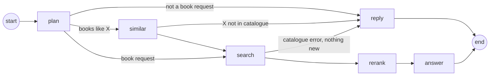

# Book Recommendation Agent: Design

How the agent in `backend/app/services/` turns a chat message into streamed, grounded book recommendations: the LangGraph pipeline, the decisions behind each step, how the tuning numbers were chosen, and what it cannot do yet.

The entrypoint is `stream_book_agent_response()` in `backend/app/services/book_agent.py`, which builds the graph. Each step lives in its own module under `backend/app/services/agent/`.

## Constraints

- **The index was rebuilt on my own Pinecone API key, with fewer books.** Gutendex, the source API, was unreliable and slow during development, so the `books-v1` namespace holds **100 books** instead of the ~1000 of the original assignment index. Everything below was tuned and measured on that smaller catalogue: author requests are often exhaustive, "more" quickly runs out, and some genres have only a handful of titles.
- **Pinecone metadata filtering is limited.** Filters are exact-value, pass/fail only: `$eq`/`$in` on strings and lists, numeric ranges, `$and`/`$or`. There is no partial, case-insensitive or regex match, no string ranges, and no "optional" or weighted clause. That is why the agent relaxes constraints by re-searching, matches titles by text rather than by filter, and needs the author name in the exact Gutenberg "Last, First" form.
- **Some limitations belong on the data side, not in the search.** Author-name variability ("Conan Doyle, Arthur" vs "Doyle, Arthur Conan"), title matching, missing publication years and cross-language duplicate editions are best fixed at ingest time, by storing normalized keys and enriched fields in the index, rather than by more heuristics in the agent. The agent handles them only as far as a search-time workaround goes; the data-side fixes are listed in [Possible next steps](#8-possible-next-steps).

## Solution in short

A stateless LangGraph pipeline behind the `/api/chat` SSE endpoint, with five steps: **plan** (one structured LLM call that gates intent and safety and extracts a store-agnostic `SearchPlan`), **similar** (for "books like X": looks X up in the catalogue and lets the LLM describe what it is like), **search** (Pinecone integrated-embedding search with metadata filters, relaxing constraints only when nothing matches), **rerank** (a cross-encoder shortlist when constraints were dropped) and **answer** (a streamed structured LLM reply, rendered to markdown as it arrives). Grounding is enforced in code: the model picks candidates by id, the book line is rendered from index data, and each pick must rate at least "partial" and quote evidence found in that book's data. Refusals, clarifications and error paths are fixed text. A typical request costs 2 LLM calls and 1 Pinecone search.

## 1. The graph

| Node | Module | LLM call | Pinecone calls | Job |
|---|---|---|---|---|
| `plan` | `agent/plan.py` | 1 | – | Is this a genuine, safe book request? If so, what is the `SearchPlan`? |
| `similar` | `agent/similar.py` | 1 | 1 + 1 per title | "Books like X": looks X up and describes what X is like |
| `search` | `agent/search.py` | – | 1, or 1 + one parallel round | Search with every constraint, relaxing only when nothing matches |
| `rerank` | `agent/rerank.py` | – | 0–1 | Shortlists 10 books, with a cross-encoder when constraints were dropped |
| `answer` | `agent/answer.py` | 1 (streamed) | – | Picks up to 5 books and streams the reply |
| `reply` | `book_agent.py` | – | – | Writes a fixed reply (refusal, clarification, errors) |

A typical request makes **2 LLM calls** (plan, then answer) and **1 Pinecone search**. "Books like X" adds one LLM call and one lookup round.

Shared modules: `models.py` (`SearchPlan`, `BookHit`, graph state), `conversation.py` (history helpers), `llm.py` (OpenAI client and the `structured()` call every step uses), `formatting.py` (markdown escaping).

## 2. A request, step by step

**"Something like Mark Twain, but darker"**

1. **plan** classifies the message as `book_request` and, in the same call, produces a plan with `similar_to_authors: ["Twain, Mark"]` and a first description of the request.
2. The plan names a reference author, so the graph routes to **similar**.
3. **similar** finds Twain's books with one exact metadata lookup. It sends their summaries, subjects and bookshelves to the LLM, which returns a search query ("humorous American adventure… darker tone") and a one-line note. The note is streamed to the user immediately. Twain is added to `exclude_authors`.
4. **search** runs the strict search with the new query. It drops books already recommended earlier in the conversation, excluded titles and authors, and duplicate editions, and keeps up to 30.
5. **rerank** sees a result that met every constraint, so it keeps the vector order and cuts the list to 10.
6. **answer** streams the reply. For each pick the model first commits to a fit rating and quotes evidence from that book's data; only checked picks are shown, with their reasons streaming as they arrive.

## 3. Steps and decisions

### 3.1 Plan, part one — intent: `agent/plan.py`

One structured-output call does both the intent check and the filter extraction: the two used to be separate calls run in parallel, which cost a wasted extraction call on every refused message and a join node. Four classes: `book_request`, `needs_clarification`, `off_topic`, `malicious`.

- **Cheap checks first.** An empty message gets a clarifying question. A message over 2000 characters is rejected without an LLM call: no real book request needs that much text, and long inputs are where injection payloads usually hide.
- **Client `system` messages are never forwarded** to any LLM (`conversation.recent_conversation`). The API accepts `role: "system"` from the browser, so forwarding it would let users rewrite our instructions.
- **Dark themes are allowed on purpose.** War, crime, violence and death fill the classics, so the prompt marks them as legitimate interests. Harmful how-to requests disguised as book requests count as malicious.
- **Refusals use fixed text.** For off-topic and malicious messages the reply is a constant, not LLM text, so a manipulated model cannot change what the user sees. Only the clarifying question is LLM-written.
- **Fail closed.** An API error or unparsable output gives a generic error reply, never a search.

### 3.2 Plan, part two — the `SearchPlan`: `agent/plan.py`

For a `book_request` the same call fills a `SearchPlan`:

| Field | Meaning |
|---|---|
| `query` | Self-contained description of the books wanted (themes, genre, mood), because it is matched against summaries |
| `authors` | Books *by* these authors (Gutenberg "Last, First" form) |
| `languages` | Only when the user explicitly asks for a language |
| `published_after` / `published_before` | Year constraints |
| `prefer_popular` | "popular", "famous", "classic" |
| `exclude_titles` / `exclude_authors` | Books the user has read or does not want |
| `similar_to_authors` / `similar_to_titles` | Reference points for "books like X" |
| `follows_up` | Decided first: the latest message builds on earlier turns |

- **Names must come from the right place** (`keep_mentioned_names`). The model tends to add authors typical of a genre ("classic detective" → Conan Doyle), which turned genre requests into author filters, or excluded the best books. After extraction, a name is kept only if it is actually written where it may come from (surnames for authors, distinctive words for titles; fuzzy for words of 5+ letters):
  - `authors` and `similar_to_*` narrow or redirect the search, so they must be in the **latest** user message. Earlier turns count only for a follow-up ("more by him", "like the first one"). That needs both the model's `follows_up` flag and a back-reference word in the message (more, him, it, the first one, similar, shorter…): the model alone marked "something gothic" after a Twain request as a follow-up.
  - `exclude_*` are preferences the user stated ("I already read…", "no Dickens"), so the whole recent conversation counts. Books recommended earlier are excluded by id in code, not by the model.
- **`sanitize` clamps the LLM output**: years in −3000…2100 (swapped if reversed), 2-letter language codes, at most 5 authors, 3 references, 20 excluded titles, 500-character query.
- **The plan knows nothing about Pinecone.** Field names and operators live in `search.py` (`plan_constraints`), so the extraction step can be tested, and the index changed, independently.

### 3.3 Similar: `agent/similar.py`

Runs only when the plan names reference authors or titles.

- **Detecting "like X" is part of the plan call**, so it costs no extra LLM call, and its user-facing note cannot appear before the intent check passes: a malicious message never gets "Mark Twain is known for…" on screen.
- **Lookup:** one exact metadata search for all reference authors (`authors $in`, top 100), plus one text search per title (top 5), all run concurrently, so the lookup round costs one search's latency. Pinecone filters only match exact values, and catalogue titles are longer than what people type ("Frankenstein; or, The modern Prometheus").
- **Subjects and bookshelves are soft signals, not filters.** They are very narrow: only 2 books in the index have "Boys -- Fiction", and they are Twain's own. Filtering on them would mostly find the reference again. They go to the LLM, which writes the new query.
- **Unknown reference → ask, don't guess.** If none of the references is in the catalogue (e.g. Stephen King), the reply asks the user to describe the mood or vibe instead.
- **The reference is excluded:** "like Twain" recommends other authors, "like Frankenstein" excludes that title but not Mary Shelley.
- If the LLM description fails, the search runs on the plan's own description of the reference, without a note.

### 3.4 Search: `agent/search.py`

1. **Strict:** all constraints joined with `$and`, top 30. Most requests end here.
2. **Relaxed, only if nothing matched:** every smaller set of constraints is searched **at once** (`asyncio.gather`), and the first set with results wins. The sets are ordered to drop as few constraints as possible, and the least important first: with years, language and author that is {language, author}, {years, author}, {years, language}, {author}, {language}, {years}, {}. Pinecone filters are strictly pass/fail, with no "optional filter" or should-clause, so this is how "drop as few constraints as possible" is expressed. The dropped constraints are reported as `relaxed_filters`.

Design points:

- **One round trip for the fallback.** Up to 7 searches run in parallel, but only on the rare fallback path; a strict hit costs one call.
- **Drop order: years → language → author.** Years are a soft preference and only approximated (below). The author goes last, because "books by X" is usually the point of the request.
- **Year filters fall back to author life years.** `first_publish_year` is missing from the whole index (the Open Library enrichment was never run on it). So "before 1900" means `first_publish_year ≤ 1900 OR max_author_death_year ≤ 1900`, and "after 1900" means `… OR min_author_birth_year ≥ 1900`. An author who died before 1900 wrote before 1900.
- **The author name goes into the fallback query text**, because the fallback steps may not filter on it.
- **Candidate clean-up** (`search`): drop books already recommended in this conversation, excluded titles (including longer full titles), excluded authors, and duplicate editions. Volumes of one edition ("[Vol. 8 of 9]") count as one work: the best-scoring record is kept.
- **No repeats across turns.** Every recommended book is rendered with its Gutenberg link. The ids are read back from earlier assistant messages (`recommended_book_ids`) without an LLM call, and excluded. The history is client-controlled, but a forged link can only *exclude* a book.
- **"Nothing new" stops the fallback.** If the strict search matched books but the user has seen or excluded them all, the agent says so (a fixed reply) instead of relaxing into books that miss the constraints.
- **Flags for later steps:** `relaxed_filters` (the user-facing names of the dropped constraints) and `exhaustive` (the strict search returned fewer than it asked for, so these are all the matching books).

### 3.5 Rerank: `agent/rerank.py`

- **Rerank only when it pays off:** when constraints were dropped (`relaxed_filters`) **and** there are more than 10 candidates. Then the pool is broad and vector order is least reliable. With 10 or fewer, the answer LLM can judge them all. Strict searches keep the fast path.
- **Cross-encoder, not an LLM.** `pinecone-rerank-v0` reads query and summary together and took ~0.7–1.2 s. `bge-reranker-v2-m3` took ~2.3 s. `cohere-rerank-3.5` is not authorized for this project. The answer step is already an LLM ranker that knows the flags, so a second LLM ranking would duplicate it and add a call.
- **Crop by rank, not by score.** Vector scores are not comparable across queries (0.55 for Sherlock Holmes, −0.03 for French books), so a fixed threshold would drop everything for some queries. The top 30 go to the reranker.
- **Popularity ordering happens after reranking** (`shortlist`), otherwise the reranker would overwrite it.
- If the reranker fails, the vector order is kept.

### 3.6 Answer: `agent/answer.py`

- **Grounding guarantee in code.** The LLM chooses books **by id** from the candidates, and the code checks every id before showing anything. See [3.7](#37-grounding-never-recommending-books-that-were-not-retrieved).
- **The answer step is the final filter, and a strict one.** Without checks, the model filled the list with loose matches (an Agatha Christie novel for "hackers thriller") and sometimes invented a justification ("Tom Sawyer … with dog characters"). Each pick now has, in this order:
  1. `fit`: `strong` (matches the core of the request), `partial` (core matches, a secondary wish does not) or `weak` (only generic traits, such as being a classic or having humour). The code drops `weak` picks.
  2. `evidence`: words copied from that book's summary or subjects. The code checks that at least 80% of its content words (stop words aside) appear in the book's title, summary, subjects or bookshelves, and drops the pick if not. This catches invented details the same way the id check catches invented books. Word coverage rather than exact phrases, because the model quotes in pieces and rewords slightly: real evidence measured 85–100% coverage, invented evidence ("Tom Sawyer … dog characters") 0–50%. An exact-phrase check dropped every pick of a normal request.
  3. `reason`, the text the user sees.

  The answer starts with `has_matches`, the model's own verdict. If it is false, the model's intro ("the catalogue has nothing on quantum computing…") streams as the answer. If it is true, the intro is held back until the first pick passes the checks. If none does, the user gets the fixed "couldn't find" reply instead of an intro that promises books.
- **True streaming.** `responses.stream(text_format=Answer)` is parsed incrementally with `jiter` (partial JSON). `AnswerRenderer` writes only what is new: reasons and closing stream token by token. A pick is checked when the model starts its `reason` key, because by then its id, fit and evidence are complete. Only then is its heading shown.
- **Fixed text where the model proved unreliable.** Three times the model ignored "don't say X": it repeated the dropped constraint in the intro, offered "more plays" when the catalogue had none, and restated the relaxation notice. So, in code:
  - When filters were dropped, the fixed notice replaces the model's intro.
  - When the results are exhaustive, the model's closing is dropped. "There are no other books in the catalogue matching your request" is added only if every candidate was recommended.
- **Escaping.** The frontend renders markdown as raw HTML, so every piece of book data and LLM text is escaped (`formatting.escape_markdown`, plus `escape_markdown_chunk` for streamed pieces).
- **Failure paths.** If the stream fails before anything is shown, the top 3 candidates are listed with the first sentence of their summaries. If it fails mid-way, the partial answer stays. No candidates gives a fixed "couldn't find" reply.

### 3.7 Grounding: never recommending books that were not retrieved

The README requires that the agent "never recommends books that were not retrieved from the index". A prompt instruction alone cannot guarantee that: in this project the model ignored "don't do X" instructions several times. So the rule is enforced in code, in layers:

| Layer | How | Where |
|---|---|---|
| **1. The model returns ids, not titles** | Picks reference a candidate `book_id`; the model never writes the book line the user sees | `Answer` / `Pick` schema |
| **2. Every id is checked before anything is shown** | Candidates are `state["books"]`, the books the search returned, shortlisted by rerank. `_retrieved_book()` looks each pick's id up there. An unknown, repeated or empty id is dropped and logged (`Dropped pick with an id that is not a candidate`), before its heading or reason is written. | `AnswerRenderer._retrieved_book` |
| **3. The book line is rendered from index data** | Title, authors and link come from the `BookHit`, never from model text | `render_heading()` |
| **4. The justification is checked too** | `weak` picks are dropped, and the `evidence` must be found in that book's data | `AnswerRenderer._start_pick`, `is_grounded()` |
| **5. Error paths stay grounded** | The fallback list shows retrieved books with their own summaries; refusals and "not in the catalogue" replies are fixed text | `answer_node`, `similar.py`, `plan.py` |

The check is stricter than the README asks: ids are verified against the 10 candidates the answer step was given, not everything Pinecone returned. Live probes for books outside the catalogue (Harry Potter, The Hunger Games, 1984, Stephen King) all got an honest "not in the catalogue" reply.

**Remaining gap: free text.** The layers cover the *list* of recommendations. The model's free text around it (intro, reasons, closing) could still *name* a book that was not retrieved, e.g. "you might also enjoy Great Expectations". No id check can catch that. It did not happen in the probes, and the prompt allows only facts from the candidate data, but nothing in code prevents it. Options are listed in [Possible next steps](#8-possible-next-steps).

## 4. State

`AgentState` (`agent/models.py`) is a `TypedDict` without reducers: each node returns a partial update that overwrites those keys. The graph is a single path, so no two nodes ever write in the same step. There is no checkpointer: the browser sends the full history with every request, so the server is stateless.

| Key | Set by | Used by |
|---|---|---|
| `messages` | input | all LLM nodes, `recommended_book_ids` |
| `reply` | plan, similar, search | routing, reply |
| `plan` | plan (query and exclusions updated by similar) | search, rerank, answer |
| `books` | search, then cut by rerank | rerank, answer |
| `relaxed_filters` | search | rerank, answer |
| `exhaustive` | search (cleared by rerank if it cuts) | answer |

One LangGraph detail to know: a key returned by a node but not declared in `AgentState` is **silently dropped**.

## 5. The numbers and why

| Constant | Value | Where | Why |
|---|---|---|---|
| `MAX_MESSAGE_CHARS` | 2000 | conversation | Longer messages are rejected before any LLM call. It is also the per-message cap on what LLMs see. |
| `HISTORY_WINDOW` | 6 turns | conversation | What every LLM call sees. Enough to resolve follow-ups ("more like the second one") while keeping prompts small |
| `SEARCH_TOP_K` | 30 | search | Enough to fill the reranker after exclusions and duplicate removal. Fewer than 30 matches from a filtered strict search means the result is exhaustive. |
| `ANSWER_CANDIDATES` | 10 | rerank | Candidates the answer LLM weighs. Also the rerank threshold: with 10 or fewer, the answer judges all of them. |
| `RERANK_DOCUMENT_CHARS` | 1500 | rerank | Title + summary, within the reranker's input limit |
| `MAX_PICKS` | 5 | answer | A readable reply. Fewer is fine when fewer fit. |
| `MIN_EVIDENCE_COVERAGE` | 0.8 | answer | Share of the evidence's content words that must appear in the book's data. Real evidence measured 0.85–1.0, invented evidence 0–0.5. |
| `SUMMARY_CHARS` | 700 | answer | 10 candidates × 700 chars keeps the answer prompt small. Summaries are short anyway. |
| Popularity shortlist | top 20 → 10 | rerank | Relevance picks the shortlist first (2 × 10), so "popular" never means "popular but off-topic" |
| Fallback list | 3 books | answer | When the LLM fails, show a few safe picks with their own summaries |
| `AUTHOR_LOOKUP_TOP_K` | 100 | similar | All books by up to 3 reference authors in one call |
| `TITLE_LOOKUP_TOP_K` | 5 | similar | The title is usually first; a few extra cover duplicate editions |
| `MAX_REFERENCE_BOOKS` | 6 | similar | Enough data for the LLM to describe a reference without a huge prompt |
| `REFERENCE_SUMMARY_CHARS` | 600 | similar | Same reasoning as `SUMMARY_CHARS` |
| `sanitize` limits | 5 authors, 3 references, 20 excluded titles, 10 excluded authors, 500-char query, years −3000…2100 | plan | Bound what an LLM can put into a Pinecone filter |

Measured on this index (median of a few runs):

| Operation | Time |
|---|---|
| One Pinecone search (the query is embedded on every call) | ~1.2 s (top 20) – ~1.7 s (top 100) |
| Cross-encoder rerank of 30 | ~0.7–1.2 s |
| Whole request, typical | 6–9 s, of which the streamed answer takes ~1.2 s |
| "Books like X" | 8–12 s, with the note appearing after ~5–6 s |

## 6. Configuration

| Variable | Default | Used for |
|---|---|---|
| `PINECONE_API_KEY` | – | Search and rerank |
| `PINECONE_INDEX_NAME`, `PINECONE_NAMESPACE` | `books`, `books-v1` | Which index to search |
| `OPENAI_API_KEY` | – | All LLM steps |
| `OPENAI_MODEL` | `gpt-4.1-mini` | All LLM steps |
| `PINECONE_RERANK_MODEL` | `pinecone-rerank-v0` | Cross-encoder rerank |
| `LOG_LEVEL` | `INFO` | Agent logs (intent, search plan, filters, rerank, dropped picks), printed next to uvicorn's |

## 7. Known limitations

**Rough edges**
- **Strict picks mean shorter lists.** The fit and evidence checks prefer two or three good picks over five loose ones. Every dropped pick is logged (`Dropped pick …`).
- **The evidence check proves facts, not fit.** It shows the quoted words are really in the book's data, not that the book matches the request. Whether it matches is the model's `fit` rating: "funny books about dogs" can still return *Alice's Adventures in Wonderland*, whose evidence (it is funny) is real, although it is not about dogs.
- **Free text can name books that were not retrieved.** See [3.7](#37-grounding-never-recommending-books-that-were-not-retrieved): the recommended list is checked in code, the surrounding prose is only guided by the prompt.
- **The intro arrives in one piece** when there are picks, because it is held back until the first pick passes the checks. The reasons still stream.
- **Nothing on screen for the first ~5 s** while plan and search run. Only "books like X" shows an early note.

**Catalogue limits**
- **100 books, mostly English, no publication years** (see [Constraints](#constraints)). Year filters approximate from author life years, and books with no author years never match a year filter.
- **No length information.** "A short book" is silently ignored.
- **Few books per author** (Twain 2, Shakespeare 4), so author requests are often exhaustive, and "more" quickly reaches "already shown".
- **Duplicate editions across languages** ("Crime and Punishment" and "El crimen y el castigo") are not merged and can take two of the 10 candidate slots.

**Matching limits**
- **Exact names only.** Author filters and the reference-author lookup need the exact Gutenberg form. "Conan Doyle, Arthur" does not match "Doyle, Arthur Conan". Pinecone filters have no partial, case-insensitive or regex matching (`$regex`, `$contains` and similar are rejected), and string ranges are not supported. The right fix is on the data side: store normalized author keys (surname, and a canonical "first last" form) as extra metadata at ingest, and have the plan step produce that key.
- **Follow-up detection is English-only.** The back-reference words are English, so in another language a follow-up such as "more by him" loses names that were only in earlier turns. The search then falls back to the query text.
- **Follow-ups rely on our links.** "Already recommended" is read from Gutenberg links in earlier replies. A client that strips them would see repeats.

**Engineering**
- **Tests run offline.** `make test` runs the pytest suite in `tests/`: a fake LLM that answers by schema and streams the answer JSON in pieces, and an in-memory catalogue with Pinecone's filter semantics (`tests/conftest.py`). One module per step (`test_plan.py`, `test_search.py`, `test_rerank.py`, `test_similar.py`, `test_answer.py`) plus `test_pipeline.py` for flows through the whole graph. Nothing talks to OpenAI or Pinecone, so the suite runs in under a second; behaviour against the live services was checked by hand.
- The OpenAI client is cached per process and bound to its event loop. That is fine under uvicorn; scripts calling `asyncio.run` several times need a fresh client.

## 8. Possible next steps

1. Close the free-text gap: a prompt rule against naming books other than the picks, plus either dropping the closing (where "you might also enjoy…" lines go) or checking quoted titles in intro, reasons and closing against the picks.
2. Tune strictness with real queries: e.g. allow `partial` picks only when there are fewer than 2 `strong` ones.
3. Stream a short status line ("Searching the catalogue…") once the intent check passes.
4. **Data-side fixes at ingest time** (see [Constraints](#constraints)): a normalized `title_key`, so titles can be matched by metadata filter instead of text search; normalized author keys and aliases, so "Dostoevsky" and "Dostoyevsky, Fyodor" meet without fuzzy matching in the agent; real publication years from Open Library, so the author-life-year approximation can go; a `work_key` shared by all editions, volumes and translations of a work, so duplicates are merged by filter rather than by title heuristics.
5. Merge cross-language editions, or prefer the user's language (a `work_key` above covers this).
6. Use a smaller, faster model for intent and filters if latency matters more than nuance.
